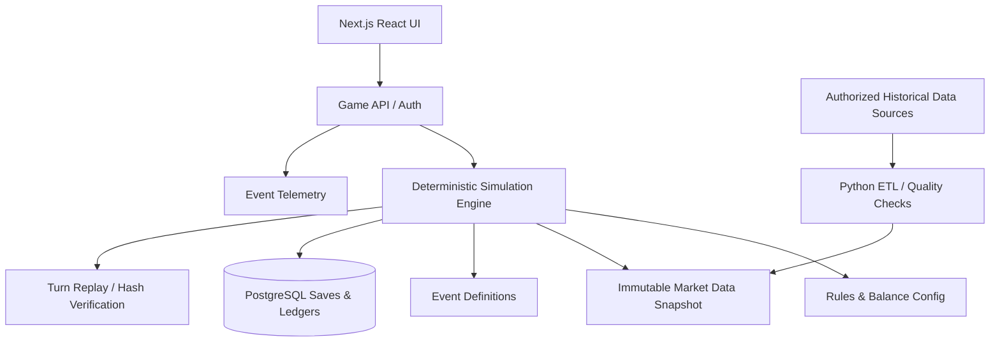
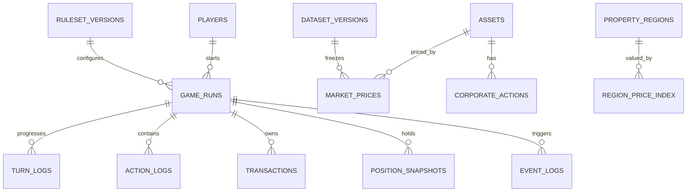

# 나는야 투자왕 — Game System & Technical Design v1.0

> **범위**: 구현 가능한 규칙·상태 전이·경제 모델·API·DB·테스트·밸런싱
>
> **연관 문서**: [PRD](./PRD_v1.0.md), [Balance Config](./BALANCE_CONFIG_v1.0.json)
>
> **모든 수치 예시는 초기 게임 설계 가설**. 2006년 실제 임금·물가·시세·당시 세율을 나타내는 사실값이 아니다. 실측 데이터가 확정된 부분만 역사모델로 취급한다.

---

## A. 시스템 아키텍처



- 코어 로직은 순수 함수 `nextState = simulate(state, queuedActions, marketData, eventSet, config, rngSeed)`를 중심으로 한다.
- 클라이언트는 계획 중인 행동을 보여주지만, 돈·능력치·거래 성공 여부는 서버가 최종 검증한다.
- 시장 데이터는 게임 런 시작 시 `dataset_version`으로 고정해 회차 중간 갱신의 영향을 차단한다.
- 데이터 ETL은 Python(pandas 등), 정산 엔진은 TypeScript pure functions, PostgreSQL 저장. 초기 단일 프로젝트 구조를 추천.

### A.1 Directory Layout

```text
src/
  app/                        # 웹 라우트 / UI
  components/game/            # 상태 표시, 차트, 거래 모달, 이벤트 카드
  core/
    state.ts                  # 타입·불변조건
    reducer.ts                # 순수 상태 전이
    turn-engine.ts            # 월별 결산 + 이벤트
    rng.ts                    # 시드 RNG
    cash-ledger.ts            # 복식/거래 원장
    scoring.ts                # 자산·인생 점수
    rules/
      career.ts
      stats.ts
      relationship.ts
      orders.ts
      housing.ts
      loans.ts
      memory.ts
  server/
    runs.ts
    market-repository.ts
    persist.ts
  content/
    events/
    books/
    jobs/
  tests/
    fixtures/
    invariant/
etl/
  pull_stocks.py
  pull_property.py
  pull_economic_indicators.py
  normalize.py
  data_quality.py
```

---

## B. 시간 모델·순서·턴 상태머신

### B.1 인덱스·날짜
- `turn_index`: 정수 0~79; `quarter = 2006Q4 + turn_index`.
- `turn_start_date`: 해당 분기 1일, `turn_end_date`: 해당 분기 마지막 날.
- `state.as_of_date`: 턴 진입시 실제로 플레이어에게 공개 가능한 정보의 마지막 시점.
- `end_run_at`: 80턴째 정산 완료 후 `2026-10-01T00:00:00+09:00` 엔딩 시점.
- 매 턴은 시세 조회/행동/시장 체결/월별 현금흐름/사건/분기말 평가 순으로 진행.
- MVP에서 1턴 내 행동 입력 순서는 사용자가 순서대로 예약한다. 액션별 즉시 결과(공부/현금 지출)는 미리보기 후 확정하고, 취업·랜덤 사건은 턴 커밋 때 계산한다.

### B.2 턴 상태
`OPEN → PLANNING → COMMITTED → SETTLING → COMPLETE → next OPEN`.
- `COMMITTED` 이후 행동 변경 불가.
- `SETTLING`에서 동일 턴 재호출은 idempotency key로 정확히 한 번만 처리.
- 예외 발생 시 트랜잭션 롤백, `COMMITTED` 상태로 복구하여 재실행.
- `turn_index=79` 정산 종료는 `RUN_COMPLETED`로 전이하고 추가 커밋 차단.

### B.3 처리 단계 (엄격한 순서)
1. 서버 측 현재 상태/버전 확인.
2. AP 소모, 선행조건, 지출 예약, 주문 예약 검증.
3. 분기 첫 거래가능일에 주문 체결(그날 **최종 체결가격은 주문 전에 공개하지 않음**). 예약 현금 초과 시 주문 거부.
4. 매월 1~3회차: 급여·부업 수입 → 생활비·주거비 → 부채이자·상환 → 예금 이자 및 만기 → 개인 사건 정산.
5. 분기 내 역사 이벤트 사실 발생 처리(뉴스는 각 실제 공개일 이후 UI에 노출).
6. 분기말 가격 반영 및 평가손익 계산. 자산평가 자체는 현금원장의 현금 입출금이 아님.
7. 건강·스트레스·관계 등 상태 변경, 트리거가 만족되는 기억 파편 지급.
8. 모든 원장·상태·사건·턴 해시 저장, 다음 턴 시작 또는 엔딩.

**주의**: 출시 수준 역사 고증을 달성하려면 월별/일별 사건 순서와 거래일 처리에 필요한 실제 데이터가 모두 존재해야 한다. 날짜가 불명확한 경우 `estimated` 플래그를 걸고 해당 내용을 P1으로 이관한다.

### B.4 상태 불변조건 (invariants)
- `turn_index ∈ [0,79]`, AP `0..3`.
- `cash >= 0`을 유지하는 매수만 체결한다(채무·연체와 별도).
- `portfolio.quantity >= 0` (공매도 미지원).
- 소수점 정밀도: 법정통화 KRW 정수 원 / USD 최소 센트 / BTC 8자리 / ETH 18자리(내부 Decimal).
- 부채·미납은 0 이상, 신용 점수 0~100.
- 거래의 돈 이동에는 반드시 균형 잡힌 원장 항목이 존재한다.
- 게임 상태는 seed+action-log+version이 같으면 결정론적으로 재현된다.

---

## C. 상태 데이터 모델

### C.1 GameState TypeScript interface 예시

```ts
type Currency = 'KRW' | 'USD';
type StatName = 'financial_knowledge' | 'career_skill' | 'execution'
              | 'health' | 'relationship' | 'credit';

type Quarter = `${number}Q${1|2|3|4}`;

interface GameState {
  runId: string;
  playerId: string;
  seed: string;
  turnIndex: number;
  quarter: Quarter;
  dataVersion: string;
  rulesVersion: string;
  eventVersion: string;
  status: 'OPEN' | 'COMMITTED' | 'SETTLING' | 'COMPLETED';
  cashKRW: bigint;
  reservedCashKRW: bigint;
  arrearsKRW: bigint;
  stats: Record<StatName, number>;       // 0..100
  wellbeing: { stress: number; happiness: number; autonomy: number; stability: number };
  career: { jobId: string | null; level: number; employmentStatus: string; monthlyNetSalaryKRW: bigint };
  housing: { type: 'FAMILY'|'RENT'|'JEONSE'|'OWN'; propertyId?: string; depositKRW: bigint; monthlyCostKRW: bigint };
  family: { partnerStatus: 'SINGLE'|'DATING'|'PARTNERED'|'MARRIED'; intimacy: number; childrenCount: number };
  holdings: Array<{ assetId: string; quantity: string; costBasisKRW: bigint }>;
  liabilities: Array<{ loanId: string; principalKRW: bigint; aprBps: number; monthsLeft: number }>;
  pendingActions: Array<{ actionId: string; params: Record<string,unknown> }>;
  orders: Array<{ orderId: string; assetId: string; side: 'BUY'|'SELL'; quantity: string }>;
  unlockedInfo: string[];
  memoryFragments: string[];
  eventFlags: Record<string, boolean|number|string>;
  ledgerSequence: number;
  stateHash: string;
}
```

- 실제 DB는 bigint 금액과 decimal 자산 수량을 사용한다. UI에서 JS `number`에 통화 금액을 누적하지 않는다.
- `monthlyNetSalaryKRW`는 **보정된 게임용 임금**. 역사 임금 데이터 검증 전에 실측치로 표기 금지.
- 순자산과 점수는 DB의 진실 원본이 아니라 원장+가격+상태로부터 계산한 derived field로 취급.

### C.2 도메인 별 파생 지표

```text
cash_available = cashKRW - reservedCashKRW
investment_value = Σ(quantity_i × priceKRW_i)
property_value = Σ(current_scenario_valuation_property)
receivables = recoverable_jeonse_deposit + other_claims
liabilities_total = Σ(loan_principal) + arrears
net_worth = cashKRW + investment_value + property_value + receivables - liabilities_total
real_net_worth = net_worth × CPI_2006Q4 / CPI_current
```

**전세 보증금**은 유동화하지 않은 계약상 반환청구 자산으로 분류하고, 신뢰성/반환 지연 위험은 별도 플래그로 설정한다. 집값과 보증금을 **중복으로 더하지 않는다**. 매수 부동산을 자산에 더하면서 주택담보대출을 부채로 차감한다.

---

## D. 캐릭터 성장·행동 규칙

### D.1 AP 기본
- 턴마다 `AP = 3`.
- AP 사용 수는 입력 순서에 따라 차감, 같은 종류 행동 반복은 허용하되 한 턴 무한 중첩을 피하기 위해 행동별 `max_per_turn` 정의.
- `work_parttime`, `study_finance`, `study_career`, `exercise`, `socialize`, `apply_job`, `start_side_hustle` 등.
- AP는 재량 시간만 뜻하며 **정규 근로에 필요한 시간·피로는 경력/건강 모델에서 별도로 부과**한다.

### D.2 성장 기본식

```text
stat_after = clamp(stat_before + base_gain × action_effectiveness × fatigue_modifier + event_effect, 0, 100)
action_effectiveness = 1 + 0.005 × relevant_stat       # 예: 지식 40이면 ×1.2
fatigue_modifier = clamp(1 - stress / 200, 0.5, 1.0)
```

- 예시: 기본 금융 공부 +6.0, 금융지식 40, 스트레스 20이면 효과 `6×1.2×0.9 = 6.48`.
- 누적 고레벨 인플레이션 방지를 위해 80 이상 구간에 diminishing return 적용 옵션(기본설정은 `gain×(1-0.005×max(0,stat-50))`).
- 책 콘텐츠는 `title`, `price`, `min_stats`, `delta`, `unlock_ids`, `era_available_from`, `action_ap_cost`로 정의.

### D.3 취업·승진

```text
eligibility = (career_skill >= job.min_skill) && (education_flags ⊇ job.required_flags)
P(job_offer) = clamp(sigmoid(-2.2 + 0.045*career_skill + 0.015*execution
                   + 0.30*job_market_index + referral_bonus), 0.05, 0.85)
```

- `job_market_index`: 해당 분기 당시 고용시장 지표/역사 이벤트로 설정. 실측 데이터가 없으면 가상의 간단 상태값이란 표시 필요.
- 오퍼 성공 시 월 순급여 `base_salary(year,job,level) × skill_modifier`. 실제 연봉 시계열 검증 전엔 기준 임금을 **게임 가상값**으로 표시.
- 정규직 취업 즉시 분기 전 3개월 급여를 소급 지급하지 않는다. `effective_month`부터 발생.
- 해고 이벤트는 경고·전직 준비·복구 선택지를 포함한다.

### D.4 건강과 스트레스

```text
stress_next = clamp(stress + workload_stress + life_event_stress - recovery, 0, 100)
health_next = clamp(health + exercise_recovery - stress_damage - illness_effect, 0, 100)
```

- 플레이어의 의사결정에 대한 기회비용이 존재하도록 건강 저하가 `fatigue_modifier`, 가끔 `available_actions`에 반영.
- 강한 개인 건강 이벤트는 예고·대응 행동을 마련하고 반복적인 질병 벌칙으로 플레이를 막지 않는다.

### D.5 관계·선택
- `partner_intimacy`는 관계 행동·돌발 사건·주거/경제 결정에 의해 변함.
- 결혼: 관계 상태·동의 이벤트·일정 조건 충족 시 선택 가능, 필수 절차 아님.
- 자녀: 선택 이벤트+가구 상태에 따른 결정. 현실의 생식 능력·건강과 도덕적 점수 연결하지 않음.
- 관계가 낮을 경우 '대화' 선택지를 먼저 제시; 숨겨진 즉사형 이혼 이벤트 최소화.

---

## E. 시장·투자 엔진

### E.1 가격과 정보의 시차

```text
info_asof(turn) = quarter_start - epsilon
visible_price(asset, turn) = latest_verified_price(asset, ts <= info_asof)
execute_price = verified_next_trading_session_price(asset, ts >= quarter_start)
price_mark_to_market(turn_end) = latest_verified_price(asset, ts <= quarter_end)
```

**원칙**: 사용자는 현재 시점 이전 정보만 보지만 실제 체결은 실제 다음 거래 가능 시점의 가격을 적용한다. 과거 데이터를 서버가 알고 있더라도 주문 미리보기에서 미래 체결가격을 보여주지 않는다.

시장에 데이터가 없으면 `NOT_LISTED`, `NO_PRICE`, `SUSPENDED`, `ILLQUID`, `RESTRICTED`로 구별. **가격 없는 자산의 거래와 근거 없는 평가금액을 금지.**

### E.2 자산 메타데이터

```json
{
  "asset_id": "BTC",
  "name": "Bitcoin",
  "asset_class": "CRYPTO",
  "listed_date": "2009-01-03",
  "trade_eligible_from": null,
  "trade_eligible_status": "RESEARCH_REQUIRED",
  "min_trade_qty": "0.00000001",
  "price_currency": "USD",
  "info_unlock": ["internet_community", "crypto_intro"],
  "market_data_version": "TBD",
  "liquidity_policy_id": "CRYPTO_EARLY",
  "corporate_action_policy": null
}
```

`trade_eligible_from=null`은 **임의로 2009년 매수 가능하게 처리하지 말 것**을 뜻한다. 최초 실제 거래 접근 가능 시점·결제수단을 검증한 후 확정한다.

### E.3 거래 수량과 수수료

```text
notionalKRW = quantity × execution_price_native × fx_krw_per_unit
fee = round(notionalKRW × fee_bps / 10,000) + flat_fee
slippage = notionalKRW × slippage_bps / 10,000
buy_cash_out = notionalKRW + fee + slippage + assessed_taxes
sell_cash_in = notionalKRW - fee - slippage - assessed_taxes
```

- 실제 금액은 모든 계산을 Decimal/Rational로 수행하고 최종 원 단위 반올림 규칙 고정.
- 보유량과 잔고를 검증하며 음수 잔고를 허용하지 않는다.
- 외화 자산의 환율 변화를 수익률에 분리 표시: `local_asset_return`, `fx_return`, `total_krw_return`.
- 배당은 해당 지급일에 현금 유입; 수정주가만 이용해 분할을 반영할 경우 별도 수량 분할을 **이중 적용하지 않는다**.
- 거래세, 배당세, 수수료는 해당 시기의 제도와 모형 충실도에 따라 정책 테이블로 관리. MVP에서 단순화시 UI에 표시.

### E.4 유동성/시장충격(비트코인 과잉 전략 대응)

```text
allowed_notional = min(
    cash_available,
    configured_asset_order_cap,
    max(0, observed_traded_value × max_participation_rate)
)

if observed_traded_value missing:
    status = 'TRADE_DISABLED_OR_RESEARCH_REQUIRED'
```

- 임의로 매수가 가능했던 것처럼 볼륨을 만들어내지 않는다.
- 실제 역사 거래량이 없으면 신뢰 가능한 거래정보를 찾거나 그 자산의 초기 투자를 잠가둔다.
- 시장에 오래 보유할 때 `custody_risk`/`exchange_failure`를 개별 사건으로 부여할 수 있으나 실제 사건과 허구적 개인 위험은 구분해서 라벨링.
- BTC/ETH는 특정 연도에 명목상 존재하더라도 사용자에게 당시 입수수단이 없을 수 있다.

### E.5 예적금

```text
monthly_interest = principal × annual_rate / 12
savings_principal[t+1] = savings_principal[t] + contribution[t]
```

- 원금보전형 가상 상품의 월 복리·단리 중 하나를 명시적으로 선택.
- 가입시 금리가 만기까지 고정되는 상품과 매 기간 변동되는 상품은 별도 모델.
- 인출 가능 여부·중도해지 패널티·예금보호를 상품 규칙에 명시.

---

## F. 부동산·대출 엔진

### F.1 매물 구성
- MVP는 실제 특정 세대 매물이 아닌 `region + property_type + floor_area_band` 수준의 **시나리오 가상 매물** 4~6개.
- 지역 거래 가격은 해당 분기/면적 구간의 실거래 중위값 등으로 추정. 데이터가 희소하면 지역 지수로 이월 보정하며 품질 플래그 표시.
- 가치 변화는 지역 지수 × 단지/면적 유형별 계수를 기본으로 하고, 실제 거래 가능한 매물 개수와 분리.
- 매물이 없으면 매수할 수 없다. 실거래가 정보는 현재 매물 무제한 공급을 의미하지 않는다.

### F.2 거래 과정
`가상 매물 탐색 → 보증금/자기자본 계산 → 대출 사전심사 → 계약(예약금) → 잔금 분기/월 → 입주 → 보유 비용/매각`.

### F.3 대출 심사(MVP 단순식)

```text
ltv_limit = appraised_value × ltv_cap_by_era_region
income_payment_limit = monthly_income × debt_service_cap - existing_monthly_debt_service
max_by_income = pv_annuity(income_payment_limit, monthly_rate, number_of_months)
loan_max = max(0, min(ltv_limit, max_by_income))
required_cash = purchase_price - loan_approved + acquisition_cost + moving_cost
```

- `ltv_cap_by_era_region`, `debt_service_cap`은 시대·지역 규제 변화에 따라 변하는 정책 시계열로 관리한다.
- 정확한 시대별 규제 데이터가 미비하면 수치를 **게임용 단순 규칙**으로 노출하고 고증 수준 L3로 올린다.
- 이자/원리금균등 상환 공식: `payment = P*r / (1-(1+r)^(-N))`, 단 `r=0`이면 `P/N`.
- 대출 승인 여부, 자기자본 부족, 잔금 부족, 기존 부채가 UI에서 미리 표시된다.

### F.4 현금흐름/상태 처리
- 매수 계약 단계의 현금은 예약/에스크로, 잔금일에 해당 자산/부채를 생성한다.
- 취득비와 주거 유지비는 비용; 대출 원금 상환은 부채 감소, 이자는 비용이다.
- 전세 보증금은 유동성 차감 + 계약상 채권 증가, 전세 반환 이벤트를 처리한다.
- 매각할 때 실제 유동성, 거래비용, 잔존 대출·담보 해제를 함께 계산.

---

## G. 삶과 경제의 연결 모델

### G.1 월별 정산

```text
cash_end = cash_start
 + net_salary + parttime_pay + side_income + deposit_interest + dividends
 - essential_living - discretionary_living - rent - loan_payment
 - tuition_and_books - relationship_spend - taxes_and_fees
 + sale_proceeds - buy_outflows + new_borrowing - principal_deposit_outflow
```

- 비용 발생 시점은 월별, 자산 가격은 거래일/분기말에 정산.
- `new_borrowing`은 자유 현금으로 자동 부여하지 않는다. 특정 거래/대출 계약에만 연결.
- 책값·직업 교육비 같은 행동 즉시 비용은 결산 시 이중 차감하지 않는다.
- 의무 지출 부족은 `arrears` 또는 명시된 대출 연체 상태로 처리한다.

### G.2 삶 지표

| 지표 | 범위 | 주요 입력 |
|---|---|---|
| health | 0~100 | 운동, 스트레스, 사건, 경력 부담 |
| relationship | 0~100 | 교류, 파트너 관계, 사회적 연결 |
| autonomy | 0~100 | 안정된 현금흐름, 자유시간, 부채 부담 |
| happiness | 0~100 | 성취, 휴식, 관계, 보편적 생활 안정 |
| stability | 0~100 | 주거 안정, 비상금, 고용 상태 |

**금지 설계**: 결혼/출산 여부 자체를 인생 점수의 직접 가산/감산 요인으로 두지 않는다. 개인의 자유와 삶의 만족은 각 경로에서 독립적으로 최적화 가능해야 한다.

### G.3 점수 (가설)

```text
wealth_score = 100 * clamp(
    ln(1 + max(net_worth, 0) / 1_000_000) / ln(1 + 3_000_000_000 / 1_000_000),
    0, 1
)
life_score = 0.30*health + 0.25*relationship + 0.20*autonomy
           + 0.15*happiness + 0.10*stability
balance_score = 0.50*wealth_score + 0.50*life_score
```

`life_score` 구성은 경제적 독립과 중복되는 `autonomy`, `stability`의 편향을 반드시 실험으로 감시한다. 삶 점수가 경제변수를 지나치게 중복 반영하면 관계/건강의 영향력을 높인다.

### G.4 경제적 자유 별도 지수(실험적)

```text
expense_cover = clamp(monthly_sustainable_nonlabor_income / max(1, monthly_essential_expense), 0, 1)
liquidity_runway = clamp(liquid_wealth / max(1, 120 * monthly_essential_expense), 0, 1)
debt_safety = clamp(1 - monthly_debt_service / max(1, 0.60 * monthly_household_net_income), 0, 1)
financial_freedom_index = 100*(0.50*expense_cover + 0.25*liquidity_runway + 0.25*debt_safety)
```

- `nonlabor_income`은 배당/이자/임대의 연평균 등 **지속 가능한 실현 현금흐름**만. 일회성 코인 매각은 제외.
- 실직 상태에서 `monthly_household_net_income=0`인데 대출이 있으면 `debt_safety=0`으로 정의.
- 현재 거주비가 가족 동거 등으로 극도로 낮아진 경우 최소 생활비 바닥값을 적용하여 지표 치팅 방지.

---

## H. 미래 기억·뉴스의 정보 모델

### H.1 정보 단계

```text
UNKNOWN → HEARD_RUMOR → RESEARCHED → VERIFIED_AT_TIME → INVESTABLE
```

- `UNKNOWN`: 종목/트렌드 존재 자체를 모름.
- `HEARD_RUMOR`: 파편 또는 커뮤니티 이벤트로 테마 인지.
- `RESEARCHED`: 공부·조사 행동 수행.
- `VERIFIED_AT_TIME`: 당시 공개 시점의 정보/상품 조건 충족.
- `INVESTABLE`: 거래 계좌·시점·현금·유동성·보관 제약 통과.

### H.2 MemoryFragment 예시

```json
{
  "id": "memory_internet_money",
  "text": "인터넷에서 태어난 낯선 화폐가 언젠가 세상의 주목을 받았던 것 같다.",
  "available_from_turn": 0,
  "max_occurrences": 1,
  "information_tags": ["digital_currency"],
  "unlock_stage": "HEARD_RUMOR",
  "contains_exact_future_price": false,
  "contains_exact_event_date": false
}
```

- 파편 2개는 시작 턴에 지급; 나머지는 특정 시점의 진행·관련 능력치·활동을 통해 해금.
- 과거 특정 인물/종목의 미래 시가총액·정확한 매수/매도 타이밍을 알려주는 문구는 허용하지 않음.
- 플레이어가 게임 밖에서 역사를 알고 있는 것은 억제할 수 없으므로 **거래 실현 가능성, 현금과 기회비용을 게임의 진짜 제약으로 설계**한다.

---

## I. 이벤트 엔진

### I.1 EventDefinition

```ts
interface GameEvent {
  id: string;
  type: 'HISTORICAL'|'PERSONAL'|'MEMORY';
  fixedQuarter?: Quarter;       // 역사 사건
  publishedAt?: string;         // 뉴스의 당시 공개 시점
  minTurn?: number;
  maxTurn?: number;
  cooldownTurns?: number;
  weight?: number;
  conditions: Condition[];
  choices: Array<{
    id: string;
    label: string;
    requirements: Condition[];
    effects: Effect[];
  }>;
}
```

### I.2 발동 알고리즘
1. `HISTORICAL` 이벤트는 분기에 맞추어 시간표대로 발동, 경기 관련 상태 변화는 이중 적용되지 않게 설정.
2. `PERSONAL` 이벤트는 사전 트리거와 쿨다운을 충족하는 집합에서 시드 기반으로 추출.
3. 사건 발생 전 플레이어에게 알려야 할 정보인지 `publishedAt <= state.as_of_date`로 검증.
4. 한 턴의 큰 개인 이벤트는 최대 1개, 작은 이벤트는 최대 2개로 제한(MVP 가설).
5. 이벤트 결과를 `run_event_log`에 기록. 재생 시 **난수를 다시 추첨하지 않고 기록된 선택/결과를 검증**할 수 있도록 RNG 호출 순서를 고정.

### I.3 확률 모델

```text
p_event = clamp(base_probability × trigger_modifier × stats_modifier × era_modifier, p_min, p_max)
rng = seeded_uniform(seed, turn_index, event_id, draw_counter)
triggered = (rng < p_event)
```

- 시드가 고정되어도 플레이어 행동으로 확률이 변하면 결과가 달라질 수 있음.
- 이벤트 랜덤 난수에 날짜·현재 금액의 문자열 표현을 넣지 말고 안정적으로 직렬화한 입력을 사용.
- `math.random()`이나 클라이언트 로컬시간에 의존 금지.

### I.4 이벤트 콘텐츠 목록 (MVP 제안)
**역사 15개**: 2007 부동산/증시 분위기, 2008 금융위기, 2009 BTC 네트워크 출범, 2010 디지털 화폐 거래 커뮤니티, 2011 유럽 재정위기, 2013 모바일 경제, 2014 KRX 금시장, 2015 ETH, 2016 국내 부동산 테마, 2017 암호화폐 관심 급증, 2018 조정, 2020 팬데믹, 2021 유동성·자산 상승, 2022 금리 환경, 2025~2026 엔딩 시대뉴스. **정확한 이벤트 문구·분기·공개 당시 근거는 추후 고증 단계에서 검증.**

**개인 25개**: 첫 취업, 면접 탈락, 승진 제안, 연봉 협상, 부당한 제안(거부 선택), 지출 증가, 이직 헤드헌팅, 창업 파트너 만남, 부업 성공, 부업 실패, 친구의 코인 추천, 관계 갈등, 화해, 여행 제안, 결혼 논의, 주거 이전, 가족 돌봄, 이사 사고, 자동차 구매 고민, 건강 검진, 스트레스 경고, 운동 성과, 책 추천, 반려동물 입양, 뜻밖의 선물. 사건 빈도와 편향을 시뮬레이션으로 보정.

---

## J. 데이터베이스 스키마 (논리모델)

### J.1 ER 관계 개요



### J.2 필수 테이블
| Table | 주요 컬럼 | 목적 |
|---|---|---|
| players | id, created_at, guest_key_hash | 익명/계정 유저 |
| game_runs | id, player_id, seed, turn_index, mode, data_version, rules_version, state_json, status | 현재 실행 |
| turn_logs | id, run_id, turn_index, state_before_hash, state_after_hash, ledger_checksum, committed_at | 재현·감사 |
| action_logs | id, run_id, turn_index, action_order, action_type, params_json, result_json | 플레이 기록 |
| transactions | id, run_id, turn_index, asset_id, side, qty, price, fee, tax, currency, executed_at | 주문 체결 |
| ledger_entries | id, run_id, turn_index, account_code, debit_krw, credit_krw, reference_id | 현금·비용·자산원장 |
| position_snapshots | run_id, turn_index, asset_id, quantity, cost_basis_krw, value_krw | 분기 보유 현황 |
| loan_contracts | id, run_id, principal, rate_bps, term, policy_version, status | 대출·상환 |
| event_logs | id, run_id, turn_index, event_id, choice_id, effect_json, rng_draw_id | 사건 결과 |
| assets | asset_id, name, class, listed_date, eligible_date, trade_rule_id | 자산 관리 |
| market_prices | asset_id, price_date, currency, close, volume, source_id, quality, dataset_version | 역사 시세 |
| corporate_actions | asset_id, effective_date, type, ratio, cash_amount, source_id | 주식 변동 |
| property_regions | id, name, region_code, property_type, floor_area_band | 부동산 시나리오 |
| region_price_index | region_id, quarter, price, sample_size, source_id, quality | 부동산 평가 |
| historical_events | event_id, event_date, publish_date, evidence_url, text, version | 사건 고증 |
| ruleset_versions | id, config_json, checksum, released_at | 밸런스 재현 |
| dataset_versions | id, period_start, period_end, approved_use, checksum | 시세 재현 |

### J.3 SQL DDL (간소 예시)

```sql
CREATE TABLE game_runs (
  id UUID PRIMARY KEY,
  player_id UUID NOT NULL,
  seed TEXT NOT NULL,
  turn_index SMALLINT NOT NULL DEFAULT 0 CHECK (turn_index BETWEEN 0 AND 80),
  mode TEXT NOT NULL DEFAULT 'FRAGMENT',
  data_version TEXT NOT NULL,
  rules_version TEXT NOT NULL,
  event_version TEXT NOT NULL,
  state_json JSONB NOT NULL,
  status TEXT NOT NULL CHECK (status IN ('OPEN','COMMITTED','SETTLING','COMPLETED')),
  updated_at TIMESTAMPTZ NOT NULL DEFAULT now()
);

CREATE TABLE market_prices (
  asset_id TEXT NOT NULL,
  price_date DATE NOT NULL,
  dataset_version TEXT NOT NULL,
  currency CHAR(3) NOT NULL,
  close NUMERIC(30,12) NOT NULL CHECK (close > 0),
  volume NUMERIC(30,12),
  quality TEXT NOT NULL,
  source_id TEXT NOT NULL,
  PRIMARY KEY(asset_id, price_date, dataset_version)
);

CREATE TABLE turn_logs (
  run_id UUID NOT NULL REFERENCES game_runs(id),
  turn_index SMALLINT NOT NULL CHECK (turn_index BETWEEN 0 AND 79),
  idempotency_key TEXT NOT NULL,
  state_before_hash TEXT NOT NULL,
  state_after_hash TEXT NOT NULL,
  committed_at TIMESTAMPTZ NOT NULL DEFAULT now(),
  PRIMARY KEY(run_id, turn_index),
  UNIQUE(run_id, idempotency_key)
);
```

`game_runs.turn_index=80`은 '모두 완료'라는 저장 포인터 상태로 허용하지만 실제 플레이 가능 턴은 0~79만 허용. 상태머신에서 `turn_index=80`인 경우 `COMPLETED`여야 한다.

---

## K. API Contract

| Method | Endpoint | 용도 |
|---|---|---|
| POST | `/api/v1/runs` | 새 회차 생성, 모드/seed 유효성 검증 |
| GET | `/api/v1/runs/{id}` | 공개 가능한 상태와 현재 시점 정보 |
| GET | `/api/v1/runs/{id}/market` | 시점별 종목/가격 as-of 필터 |
| GET | `/api/v1/runs/{id}/actions` | 선택 가능한 행동/비용/해금 조건 |
| POST | `/api/v1/runs/{id}/preview` | 행동·거래 계획 서버 검증, 예상 상태 (미래 가격 없음) |
| POST | `/api/v1/runs/{id}/commit` | 턴 1회 확정·정산·자동저장 |
| GET | `/api/v1/runs/{id}/history` | 턴별 재무·인생 기록 |
| GET | `/api/v1/runs/{id}/ending` | 엔딩 집계(완료 회차만) |
| GET | `/api/v1/challenges/{season}/leaderboard` | 공식 시드/규칙 버전별 랭킹 |

### K.1 턴 커밋 요청/응답 예시

```json
{
  "turnIndex": 0,
  "stateHash": "sha256:previous-state",
  "idempotencyKey": "7f09a3f3-e312-40f8-a490-c1a2a95ed912",
  "actions": [
    {"actionId": "PART_TIME", "params": {"jobType": "CAFE"}},
    {"actionId": "READ_BOOK", "params": {"bookId": "FINANCE_INTRO_01"}},
    {"actionId": "EXERCISE", "params": {"type": "WALK"}}
  ],
  "orders": []
}
```

```json
{
  "runId": "example-run-uuid",
  "settledTurn": 0,
  "nextTurn": 1,
  "nextQuarter": "2007Q1",
  "ledgerDeltaKRW": -75000,
  "newStateHash": "sha256:new-state",
  "eventIds": ["FIRST_WORK_EXPERIENCE"],
  "status": "OPEN"
}
```

수치는 UI·API 설명용 픽스처일 뿐 역사 자료가 아니다.

### K.2 서버 오류
- `INVALID_ACTION`, `NOT_UNLOCKED`, `INSUFFICIENT_CASH`, `INVALID_LOT`, `NO_PRICE`, `ILLIQUID`, `WRONG_TURN`, `CONFLICT_STATE_HASH`, `ALREADY_COMMITTED`, `RUN_COMPLETED`.
- 에러 메시지는 '왜 불가한지'와 '할 수 있는 대체 행동'을 알려준다.
- 재시도 가능한 오류(데이터 일시 누락)와 불가능한 오류(미상장)는 명확히 구분한다.

---

## L. 밸런싱·시뮬레이션·봇 테스트

### L.1 비교 봇 (최소 7개)
1. **현금저축 봇**: 근로 소득 중심, 예적금 위주.
2. **주식 적립 봇**: 정해진 투자 비율로 주식 분산 투자.
3. **BTC 탐색 봇**: 일찍 IT·금융 공부, 적법한 거래시점 이후 집중 투자.
4. **부동산 봇**: 현금 확보 후 주거 투자, 대출 심사 통과 시 진입.
5. **사업가 봇**: 실행력과 사업 중심.
6. **인생균형 봇**: 건강·관계·저축에 3 AP 균형 배분.
7. **무작위 합법행동 봇**: 취할 수 있는 행동만 랜덤 선택(바닥선).

### L.2 시뮬레이션 검증
- 동일 정책 봇을 1,000개 고정 시드로 반복.
- `net_worth_p10/p50/p90`, `life_score`, `balance_score`, `completion_rate`, `insolvency_rate`, `action_distribution`, `time_to_first_property`, `market_concentration` 수집.
- 매개변수 바꿔 `balance_config_version`마다 지표 비교.
- 절대 '투자 정보 습득했는데 거래할 자산이 없어서 경제적으로 파멸'하는 시작 장애가 없어야 한다.
- BTC 봇이 무조건 최상위인 경우, 허구적 가격 변경이 아닌 **검증 가능한 실제 접근/유동성 제약 및 시간 기회비용**을 먼저 확인한다.
- 유저에게 결과가 불공정해 보이면 제약의 이유를 명시하고 메인 챌린지와 자유 샌드박스를 분리한다.

### L.3 경제적 건강성 KPI
- 1~4턴 모든 초심자 경로에서 즉시 파산에 빠지는 케이스 비율.
- 20턴까지 인생 행동 중 독점적 필수 행동(매 턴 반드시 선택해야 하는 단 하나의 행동) 유무.
- 상위 1%·중위 50% 순자산 격차, 상위 빌드 독점 정도.
- 부/건강/관계 모두를 최대화할 수 있는 지배 전략 존재 여부(피해야 함).
- 현금원장 불일치 0, 중복 턴 실행 0, 불가시점 자산 거래 0.

---

## M. QA 테스트 케이스

| ID | Preconditions | Actions | Expected |
|---|---|---|---|
| QA-01 | 2006Q4, 새 회차 | 80턴 커밋 | 2026Q4 입구 엔딩, 81턴 불가 |
| QA-02 | 2006Q4, BTC 보이지 않음 | BTC 매수 요청 | NOT_UNLOCKED 또는 RESTRICTED |
| QA-03 | 2013Q4 | KRX GOLD 매수 | NOT_LISTED |
| QA-04 | 2014Q2 이후, 계좌 미보유 | KRX GOLD 매수 | 계좌 개설조건 오류 |
| QA-05 | 2014Q4 | ETH 매수 | NOT_LISTED |
| QA-06 | 주문액 1,000,001원, 현금 1,000,000원 | 매수 | INSUFFICIENT_CASH |
| QA-07 | 0원 현금, 고정생활비 존재 | 턴 결산 | 미납 발생, 음수 현금 없음 |
| QA-08 | 턴0 동일 요청 2회 | commit twice | 한 번만 정산 |
| QA-09 | 다른 seed, 같은 시장/행동 | 턴 정산 | 시장 가격 동일, 개인 이벤트는 다를 수 있음 |
| QA-10 | 동일 seed, 행동/버전 동일 | 리플레이 | state hash 완전 일치 |
| QA-11 | 2008Q1 | 미래 뉴스 API 호출 | 2008Q4 뉴스 반환 금지 |
| QA-12 | 배우자·자녀 없음 | 80턴 플레이 | 정상 엔딩, 직접 점수 패널티 없음 |
| QA-13 | 주식 액면분할 발생 | 보유량·가격 보정 | 기업행위 평가액 보존(시장변동 별도) |
| QA-14 | 2026Q3 종료 후 | 2026Q4 거래 요청 | RUN_COMPLETED |
| QA-15 | 부동산 매수, LTV 조건 미충족 | 구매 요청 | 자금부족 및 정책 사유 표시 |
| QA-16 | 가격 데이터 누락 | 매수 요청 | NO_PRICE, 0원/직전가 임의 체결 없음 |

---

## N. 현실 데이터 공급·ETL 스펙

### N.1 ETL 파이프라인

```text
Historical Sources → Raw Archive → Validation/Normalization → Asset Master
 → Corporate Actions & FX → Point-in-Time Visibility / Quality Flags
 → Monthly/Quarterly Dataset → Version Freeze → Simulator
```

### N.2 데이터 품질 게이트
- 가격 > 0; 날짜 유효; 상장 이전·상장폐지 이후 기록 점검.
- 수익률 급변과 기업행위 분리. 배당·분할 효과 이중 적용 금지.
- 한국 시간(KST) 기준 거래일/해외 장날짜 매핑, 주말/휴장일 체결 금지.
- 환율 결측, 서로 다른 통화의 가격 혼용 탐지.
- 부동산: 지역별 거래 수, 가격 분포, 아파트명 이력, 면적 변동, 이상치 및 재공시 버전 관리.
- 거래량 없으면 초창기 암호화폐 고액 매수 금지.
- `source_license_status ∈ {APPROVED, RESTRICTED, UNKNOWN}`; UNKNOWN은 배포 빌드에 포함하지 않는다.

### N.3 중요한 역사 시점(검증된 일부)
| 사실 | 날짜 | 구현 의미 |
|---|---|---|
| 부동산 매매 실거래 공개 시계열 | 2006년 1월부터 | 초기 부동산 시나리오 근거 확보 가능 |
| BTC genesis | 2009-01-03 | 네트워크 등장(매매 가능 시점과 다름) |
| KRX Open API 시세 기본 범위 | 2010년 이후 | 2006~2009 소스 추가 확보 |
| KRX 금시장 정식 개장 | 2014-03-24 | 별도 금계좌 거래 해금 기준 |
| ETH 메인넷 시작 | 2015-07-30 | 그 이전 ETH 현물 불가 |

### N.4 근거 URL
- 실거래가 공개 범위: https://rt.molit.go.kr/pt/info/info.do
- 실거래 API: https://www.data.go.kr/data/15126469/openapi.do
- KRX API: https://openapi.krx.co.kr/contents/OPP/INFO/service/OPPINFO004.cmd
- R-ONE 신규 API 안내: https://www.reb.or.kr/reb/na/ntt/selectNttInfo.do?mi=10251&nttSn=98700
- 금시장 개장: https://fsc.go.kr/po010101/71087
- BTC 출범: https://help.blockstream.com/education/glossary/genesis-block
- ETH 출범: https://ethereum.org/ethereum-history-founder-and-ownership/

---

## O. 구현 착수 순서·완료 정의 (Definition of Done)

### O.1 Day-1 개발 태스크
- [ ] `GameState`, `TurnIndex`, `RulesVersion` 타입 정의
- [ ] `simulate()` 결정론 함수 뼈대 + RNG 구현
- [ ] 2006Q4~2026Q3 달력 생성 및 테스트
- [ ] 원장 차변/대변 검증, 잔고 원칙 구현
- [ ] mock 가격 CSV 3자산으로 80턴 실행(명확히 가상 픽스처)
- [ ] `PART_TIME`, `READ_BOOK`, `EXERCISE` 3개 행동 구현
- [ ] 소득/생활비 3개월 정산 구현
- [ ] `commit_turn` 멱등 저장 구현
- [ ] 80턴 자동봇 완주 테스트
- [ ] UI: 대시보드, 행동 패널, 다음 분기 버튼 연결

### O.2 MVP Feature Complete
- 최소 1종의 합법적인 투자 전략과 1종의 노동·저축 전략으로 80턴을 완주할 수 있다.
- 역사 데이터의 미검증 부분은 명시적 mock 또는 '거래불가'이며 실제 역사 데이터라고 표시하지 않는다.
- 어떤 거래도 미래의 확인된 가격으로 주문 전 체결 보장을 약속하지 않는다.
- 모든 게임 세션은 재시작/저장/리플레이가 가능하다.
- 엔딩 점수는 원장·점수식과 재현 가능하게 일치한다.

---

## P. 검토할 주요 설계 선택 (v1.1 논의)

1. **80턴 플레이시간**: 1턴 30~60초면 40~80분이다. 완주 목표 30~45분을 맞추려면 평균 **22~34초/턴**이 필요하다. 실제 계측 후 속도 모드/행동 템플릿을 개발한다.
2. **AP 3과 정규직 피로**: 직업을 유지해도 AP를 동일하게 주는 것은 단순하지만 현실성은 떨어진다. 초반에는 스트레스/건강으로만 표현하고 복잡도는 차기 버전으로 미룬다.
3. **자산 점수 상한**: 30억 임계값은 임의 가설이며 BTC 빌드가 수백억을 만들 경우 점수 포화. 로그변환/구간 임계값의 재미를 AB 테스트한다.
4. **커뮤니티 공개 랭킹**: 미래 역사 지식을 아는 실제 유저와 모르는 유저가 경쟁하므로 투자 수익률만이 아닌 '공식 동일 시드 + 삶 균형' 평가가 필요하다.
5. **경제위기 고증**: 각 사건의 실제 공표 날짜와 게임 내 뉴스 텍스트 날짜를 분리해야 look-ahead bias를 방지할 수 있다.

---

## Q. 다음 산출물

- A. Figma/HTML 와이어프레임: 대시보드 + 시장 + 부동산 + 엔딩
- B. 게임 규칙 JSON 스키마와 시드 이벤트 40개 정식 세트
- C. 유효 데이터 확보용 `data_source_inventory.csv` 및 ETL PoC
- D. headless turn engine 코드와 1,000회 정책봇 시뮬레이션 결과

**이 문서의 목적은 게임의 의도와 실행 규칙을 분리해 고증·UX·경제 모델을 병렬 개발할 수 있도록 하는 것이다.**
